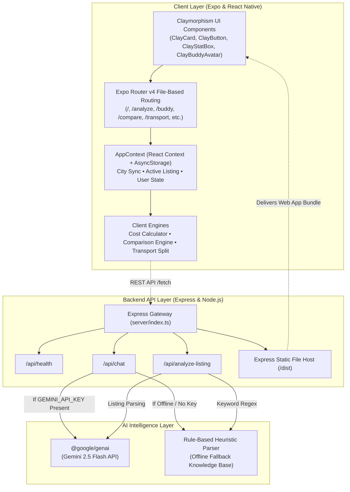

# 🏠 PG Proof — Student City Accommodation & Companion App

> **Check. Compare. Choose.**  
> A production-ready mobile and web application built for students relocating to new Indian cities (Indore, Bengaluru, Pune, Delhi NCR, Mumbai, etc.). Features a tactile **Claymorphism / Clay Art UI design system**, an integrated **AI Rental Assistant ("PG Proof Buddy")**, scam alert intelligence, and a comprehensive **City Companion Suite**.

[](https://expo.dev)
[](https://reactnative.dev)
[](https://www.typescriptlang.org)
[](https://nodejs.org)
[](https://expressjs.com)
[](https://ai.google.dev)
[](https://render.com)

---

## 📑 Table of Contents
- [Problem Statement & Vision](#-problem-statement--vision)
- [System Architecture](#-system-architecture)
- [Technology Stack](#-technology-stack)
- [Tactile Claymorphism Design System](#-tactile-claymorphism-design-system)
- [Key Features & Engines](#-key-features--engines)
- [Directory Structure](#-directory-structure)
- [Project Setup & Installation](#-project-setup--installation)
- [Environment Variables](#-environment-variables)
- [Deployment on Render](#-deployment-on-render)
- [Automated Testing & Validation](#-automated-testing--validation)
- [License](#-license)

---

## 🎯 Problem Statement & Vision

Moving to a new city for higher education or an internship is often fraught with hidden pitfalls:
1. **Hidden Rental Traps**: Landlords advertise nominal rents (e.g. ₹9,000/mo) but enforce non-refundable deposits, arbitrary exit painting charges (₹5,000+), high electricity sub-meter markups (₹12–₹15/unit vs residential ₹6–₹8), and mandatory meal fees.
2. **Deposit & Agreement Exploitation**: Strict lock-in periods, curfew gate-locking, and refusal to refund security deposits.
3. **Local Transit & Daily Commute Confusion**: Overpaying auto-rickshaws without knowing student bus concessions (BMTC/PMPML/AiCTSL passes), metro station feeder routes, or bike taxi options.
4. **Scams & Fake Listings**: Demands for "Google Pay token advances" before physical room visits or QR code phishing.

**PG Proof** gives students transparency through:
- Algorithmic calculation of **Total Recurring Monthly Cost** vs. **First-Month Cash Outlay**.
- An explainable, side-by-side **Comparison Engine** ("Why this recommendation?").
- **PG Proof Buddy**: A live AI rental detective trained on tenant rights, agreement red flags, and polite WhatsApp negotiation scripts.
- A **City Companion Suite** covering transit fare splits, student tiffin meal plans, scam alerts, and 24x7 emergency essentials.

---

## 🏗️ System Architecture

PG Proof operates as a full-stack, unified architecture. The client is universal (React Native + Expo Web), communicating with an Express AI Gateway that can either run standalone or host the production web build as a single-port service.



---

## 💻 Technology Stack

| Domain | Technology | Version | Purpose |
|---|---|---|---|
| **Core Framework** | [React Native](https://reactnative.dev) | `0.86.3` | Cross-platform native & web rendering engine |
| **App Platform** | [Expo](https://expo.dev) | `~57.0.27` | Universal application toolchain |
| **Routing** | [Expo Router](https://docs.expo.dev/router/introduction/) | `~57.0.25` | Type-safe file-based navigation |
| **Language** | [TypeScript](https://www.typescriptlang.org) | `~6.0.3` / `5.7` | Strict end-to-end type safety |
| **Web Rendering** | `react-native-web` | `~0.21.0` | High-fidelity DOM translation for web browsers |
| **Local Storage** | `@react-native-async-storage/async-storage` | `2.2.0` | Client-side persistent cache for settings & saved PGs |
| **UI Aesthetics** | Vanilla React Native `StyleSheet` | Built-in | Custom **Claymorphism** 3D design system (no Tailwind) |
| **Icons & Media** | `@expo/vector-icons` (Ionicons) | `^15.0.2` | Consistent tactile vector symbols |
| **Server Runtime** | [Node.js](https://nodejs.org) | `20.x` | Backend runtime environment |
| **Backend Framework** | [Express](https://expressjs.com) | `^4.21.2` | REST API gateway & static web host |
| **AI Inference** | `@google/genai` (Google Gen AI SDK) | `^2.28.0` | Direct integration with Gemini 2.5 Flash |
| **Test Runner** | `tsx` | `^4.23.15` | Fast TypeScript execution for unit tests |
| **Deployment** | [Render](https://render.com) | Cloud | Unified full-stack web service via `render.yml` |

---

## 🎨 Tactile Claymorphism Design System

PG Proof features an authentic **Claymorphism / Clay Art aesthetic** inspired by soft clay sculptures and modern neumorphic principles:

1. **3D Bottom Bevel Borders**:
   Every card and button combines a subtle 2px border with a **3.5px to 4px darker bottom bevel** (`borderBottomColor`), creating an authentic squishy tactile bevel:
   - `blue`: Surface `#F0F9FF`, Border `#BAE6FD`, Bottom Bevel `#7DD3FC`
   - `mint`: Surface `#F0FDF4`, Border `#BBF7D0`, Bottom Bevel `#86EFAC`
   - `lavender`: Surface `#F5F3FF`, Border `#DDD6FE`, Bottom Bevel `#C4B5FD`
   - `peach`: Surface `#FFF7ED`, Border `#FED7AA`, Bottom Bevel `#FDBA74`
   - `cream`: Surface `#FEFCE8`, Border `#FEF08A`, Bottom Bevel `#FDE047`
   - `rose`: Surface `#FFF1F2`, Border `#FECDD3`, Bottom Bevel `#FDA4AF`

2. **Top Gloss Inner Sheens**:
   Embedded highlight layers (`rgba(255, 255, 255, 0.45 – 0.95)`) simulate light reflecting off polished clay models.

3. **Multi-Stop Soft Drop Shadows**:
   Dual shadows calibrated in [`src/constants/clayTheme.ts`](file:///Users/aniruddhshukla/atla%20sprint/pg-proof/src/constants/clayTheme.ts) (`ClayShadows.pod`, `ClayShadows.card`, `ClayShadows.cardElevated`, `ClayShadows.button`, `ClayShadows.pill`).

4. **Spring Micro-Interactions**:
   Squishy animated responses on press (`transform: translateY(2px)`, scale down to `0.97` on press-in, spring release).

---

## 🌟 Key Features & Engines

### 1. 🤖 PG Proof Buddy (AI Rental Detective)
- Live AI conversational assistant integrated with Google Gemini 2.5 Flash.
- Understands **Hinglish** and **English** naturally.
- Capable of drafting polite yet firm WhatsApp negotiation templates, evaluating lease clauses, and explaining tenant rights.
- **Fail-safe fallback**: Automatically switches to an offline heuristic engine if no API key is provided.

### 2. 💰 Financial & Hidden Cost Calculator
- Computes both **Recurring Monthly Cost** (Rent + Maintenance + Electricity + Food + Laundry) and **First-Month Cash Outlay** (Deposit + Advance + Brokerage + Move-in Fee).
- Automatically flags hidden fee traps like non-refundable exit painting charges or high electricity sub-meter markups.

### 3. ⚖️ Side-by-Side Comparison & Explainability Engine
- Compares 2 or more accommodations simultaneously.
- Scores candidates against student budget constraints, critical red flags, and commute time.
- Generates a human-readable **"Why This Recommendation?"** breakdown.

### 4. 🚌 Student City Companion Suite
- **Transport Guide**: Covers metro routes, bus systems (BMTC, PMPML, AiCTSL), shared autos, and bike taxis. Dynamically calculates passenger fare splits and peak-hour traffic multipliers for Indore, Bengaluru, Pune, Delhi NCR, and Mumbai.
- **Scam Alerts**: Community checklist of verified rental traps, QR code scams, and advance deposit fraud.
- **Food & Tiffin Guide**: Curated homestyle dabbas and thalis with per-meal cost comparisons against Swiggy/Zomato.
- **City Starter Kit**: Crucial local student essentials (24x7 chemists, print hubs, urgent medical centers).

---

## 📁 Directory Structure

```
pg-proof/
├── render.yml                 # Render Blueprint configuration
├── render.yaml                # Alternative Render Blueprint spec
├── package.json               # Root dependencies & build scripts
├── tsconfig.json              # TypeScript root configuration
├── README.md                  # Comprehensive documentation
├── dist/                      # Exported static web application (generated)
│
├── server/                    # Backend AI Gateway & Web Host
│   ├── index.ts               # Express API endpoints & static serving
│   ├── package.json           # Server dependencies (@google/genai, express)
│   ├── tsconfig.json          # Server TypeScript configuration
│   └── .env.example           # Environment variable template
│
└── src/
    ├── app/                   # Expo Router Pages
    │   ├── _layout.tsx        # App root layout, header & AppProvider
    │   ├── index.tsx          # Home dashboard (rearranged clay blocks)
    │   ├── analyze.tsx        # PG listing parser & red flag scanner
    │   ├── buddy.tsx          # Real-time chat with PG Proof Buddy
    │   ├── compare.tsx        # Side-by-side comparison screen
    │   ├── report.tsx         # Comprehensive PG analysis report
    │   ├── transport.tsx      # Transport Guide & fare split engine
    │   ├── food.tsx           # Food & tiffin subscription guide
    │   ├── scams.tsx          # Scam alerts & prevention checklist
    │   ├── starter-kit.tsx    # Emergency & student city essentials
    │   └── plan.tsx           # Budget planning & savings simulator
    │
    ├── components/
    │   └── clay/              # Tactile Claymorphism UI Library
    │       ├── ClayCard.tsx       # 3D bevelled clay card
    │       ├── ClayButton.tsx     # Animated squishy button
    │       ├── ClayStatBox.tsx    # Metric display tile
    │       ├── ClayHeader.tsx     # City & budget preference topbar
    │       ├── ClayBuddyAvatar.tsx# Interactive animated clay avatar
    │       ├── ClayInput.tsx      # Inset tactile input box
    │       ├── ClayBadge.tsx      # Pastel status badge
    │       ├── ClayPill.tsx       # Filter & selectable pill
    │       └── ClayTabBar.tsx     # Bottom navigation tabs
    │
    ├── constants/             # Tokens & Verified Datasets
    │   ├── clayTheme.ts       # Color palettes, radii, and clay shadows
    │   ├── sampleListings.ts  # Verified accommodations (Indore, Bengaluru, etc.)
    │   ├── transportData.ts   # City-wise transit options & fares
    │   ├── foodData.ts        # Tiffin services & mess plans
    │   ├── scamData.ts        # Known rental scams & warning checklist
    │   └── starterKitData.ts  # Emergency contacts & print shops
    │
    ├── context/
    │   └── AppContext.tsx     # Global state management & AsyncStorage sync
    │
    ├── types/
    │   ├── pg.ts              # PG listing & cost breakdown interfaces
    │   └── studentCompanion.ts# Transit, food, and scam data models
    │
    └── utils/
        ├── costCalculator.ts  # INR formatting & outlay math
        ├── comparisonEngine.ts# Recommendation scoring algorithm
        ├── studentBudgetEngine.ts # Budget projections
        └── __tests__/         # Automated Unit Test Suites
            ├── costCalculator.test.ts
            ├── comparisonEngine.test.ts
            ├── studentBudgetEngine.test.ts
            └── transportEngine.test.ts
```

---

## 🚀 Project Setup & Installation

### Prerequisites
- [Node.js](https://nodejs.org) `v18.x` or `v20.x`
- `npm` (comes with Node.js)

### 1. Clone the Repository
```bash
git clone https://github.com/Aniruddh1702/Ai-Sprint.git
cd Ai-Sprint
```

### 2. Install App Dependencies
```bash
npm install
```

### 3. Install Backend Dependencies
```bash
cd server
npm install
cd ..
```

### 4. Run the Development Environment

You can run the app in **unified full-stack mode** or in **development mode**:

#### Option A: Unified Full-Stack Mode (Recommended)
Builds the web bundle and launches the unified Express server on `http://localhost:3001`:
```bash
npm run build
npm run serve
```
Open `http://localhost:3001` in your browser.

#### Option B: Expo Dev Server (with Hot Reloading)
In Terminal 1 (AI Server):
```bash
cd server
npm start
```
In Terminal 2 (Expo App):
```bash
npm run web
# or: npx expo start
```
- Press `w` to open the web app.
- Scan the displayed QR code with the **Expo Go** mobile app on Android or iOS.

---

## 🔐 Environment Variables

The backend can optionally connect to Google Gemini for live LLM responses. If no key is set, the application automatically uses its built-in rule-based heuristic knowledge base.

To enable live Gemini AI:
1. Navigate to the `server/` folder.
2. Copy `.env.example` to `.env`:
   ```bash
   cp server/.env.example server/.env
   ```
3. Add your API key:
   ```env
   PORT=3001
   GEMINI_API_KEY=AIzaSyYourGeminiApiKeyHere
   ```

---

## ☁️ Deployment on Render

The repository contains [`render.yml`](file:///Users/aniruddhshukla/atla%20sprint/pg-proof/render.yml) and [`render.yaml`](file:///Users/aniruddhshukla/atla%20sprint/pg-proof/render.yaml) for **1-click zero-configuration deployment**:

1. Log into your **[Render Dashboard](https://dashboard.render.com)**.
2. Click **New +** ➔ select **Blueprint**.
3. Connect your repository: `https://github.com/Aniruddh1702/Ai-Sprint.git`.
4. Click **Apply**.

Render will automatically:
- Install root and server dependencies (`npm install && npm run build`).
- Export the static Expo web app into `dist/`.
- Start the server (`npm run serve`), serving both the web UI and `/api/*` on port `$PORT`.
- Perform automated health checks on `/api/health`.

---

## 🧪 Automated Testing & Validation

PG Proof includes automated unit tests covering all financial, recommendation, and transit engines:

```bash
npm test
```

### Test Coverage Summary:
- ✅ **Cost Calculator Suite** (`costCalculator.test.ts`): Verifies recurring monthly costs, security deposit logic, first-month cash formulas, and edge cases.
- ✅ **Comparison Engine Suite** (`comparisonEngine.test.ts`): Tests recommendation scoring, hidden cost identification, and explainability output.
- ✅ **Student Budget Engine Suite** (`studentBudgetEngine.test.ts`): Validates multi-month projection scenarios and living allowance models.
- ✅ **Transport Engine Suite** (`transportEngine.test.ts`): Verifies fare split calculations, vehicle vs. per-person fares, and city-specific transit options.

### TypeScript Type Check:
```bash
npx tsc --noEmit
```
Ensures 100% strict type safety across all components and screens.

---

## 📄 License

This project is licensed under the MIT License. See [LICENSE](LICENSE) for details.
